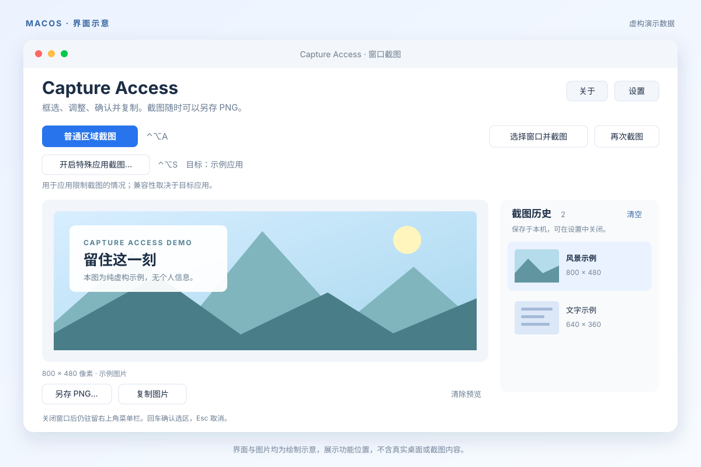
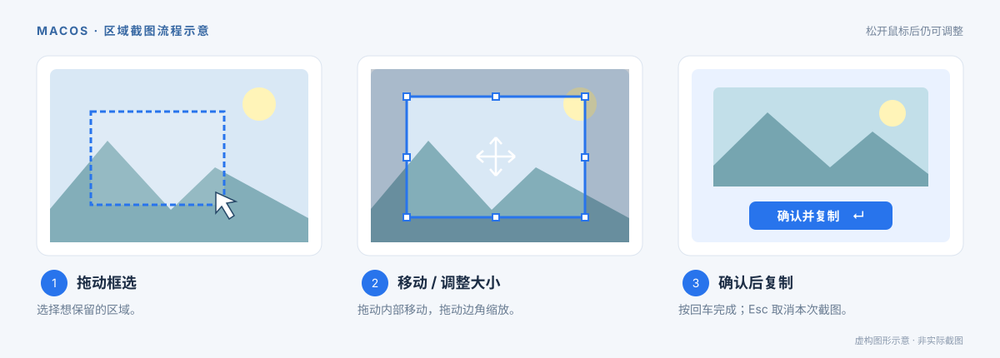
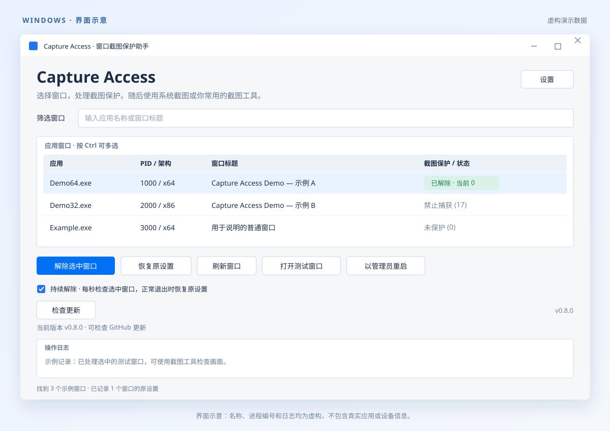

# Capture Access

**Windows 窗口截图保护处理工具 · macOS 菜单栏截图工具**

Capture Access 为两个平台提供不同的操作方式：Windows 版处理所选窗口的截图保护标志，之后使用系统或其他截图工具截取画面；macOS 版直接提供区域截图、选区调整、复制、PNG 保存和本地历史记录。

[下载最新版本](https://github.com/d-c-huang/capture-access/releases/latest) · [macOS 使用说明](macos/README.txt) · [Windows 使用说明](windows/README.txt)

## 下载

从本仓库的 [GitHub Releases](https://github.com/d-c-huang/capture-access/releases) 下载对应平台的压缩包，并完整解压。

| 平台 | 安装包 | 系统与架构 |
| --- | --- | --- |
| macOS | [CaptureAccess-macOS-universal.zip](https://github.com/d-c-huang/capture-access/releases/latest/download/CaptureAccess-macOS-universal.zip) | macOS 14 或更新版本；Apple Silicon / Intel |
| Windows | [CaptureAccess-Windows.zip](https://github.com/d-c-huang/capture-access/releases/latest/download/CaptureAccess-Windows.zip) | Windows 10 x86/x64、Windows 11 x64；不支持 ARM64 |

macOS 解压后打开 `CaptureAccess.app`；Windows 打开 `CaptureAccess.exe`，并保留同目录的 `bin` 等配套文件。发布包的签名与验证范围请查看对应 Release 说明。

## 示例图片

以下图片均为**绘制的界面示意，使用虚构演示数据**，并非用户桌面或聊天截图。图中的应用名称、进程编号、日志和图片均不来自真实使用记录。

### macOS：截图、预览与历史



### macOS：框选后可以继续调整



松开鼠标不会直接完成。拖动选区内部可移动，拖动边线或控制点可调整大小；按 **Return** 或点击“确认并复制”完成，按 **Esc** 取消。

### Windows：选择窗口并处理保护



## 功能对照

| 功能 | macOS | Windows |
| --- | --- | --- |
| 主要工作方式 | 直接截取区域或所选窗口 | 处理所选窗口的 `SetWindowDisplayAffinity` 保护标志 |
| 普通区域截图 | 支持，选区可移动和缩放 | 使用系统或其他截图工具 |
| 特殊应用处理 | 在设置中选择兼容应用，开启特殊截图模式 | 从窗口列表选择目标，执行解除操作 |
| 图片保存与历史 | PNG、复制、本地历史、关闭历史及清空 | 由所用截图工具负责 |
| 可修改截图热键 | 普通截图与特殊截图分别设置 | 不提供截图热键 |
| 版本检测与 GitHub 下载 | 支持 | 支持 |
| 登录时自动启动 | 设置中可选，默认关闭 | 设置中可选，默认关闭 |

## macOS 快速开始

1. 打开应用。右上角菜单栏会出现截图图标，首次启动会显示设置。
2. 普通截图无需选择特殊应用。按 **Control + Option + A**，拖动框选，调整选区后确认。
3. 如需处理禁止截图的应用，在设置中选择目标，再开启特殊模式。首次开启会重启目标应用一次，请先保存正在编辑的内容。
4. 按 **Control + Option + S** 触发特殊截图。工具会尝试切到目标应用，并读取其当前页面。
5. 在主窗口预览、复制或另存 PNG。历史默认保存在本机，可在设置中关闭，也可清空已有记录。

“特殊截图应用”指在 Mac 上主动禁止或限制用户截图的应用，普通截图可能出现黑屏、透明图片或遗漏该窗口。特殊方式目前仅适用于部分兼容的 Electron 页面应用，不保证所有应用都支持。

普通区域截图需要 macOS 屏幕录制权限。每次选区位于一块显示器内；确认得到的是开始框选时的画面。关闭工具窗口后，菜单栏与热键仍可使用。

| 默认热键 | 操作 |
| --- | --- |
| Control + Option + A | 普通区域截图 |
| Control + Option + S | 特殊应用区域截图 |
| Return / Enter | 确认选区并复制 |
| Esc / 鼠标右键 | 取消当前框选 |
| Command + , | 打开设置 |

两组截图热键均可在设置中修改。详见 [macOS 使用说明](macos/README.txt)。

## Windows 快速开始

1. 完整解压安装包并打开 `CaptureAccess.exe`。
2. 刷新窗口列表，按应用名称或窗口标题筛选，选中需要处理的窗口。
3. 点击“解除选中窗口”，再用系统或其他截图工具检查画面。
4. 可启用“持续解除”定期检查选中的窗口；完成后点击“恢复原设置”，正常退出时也会尝试恢复。

Windows 界面采用与 macOS 相近的清晰分区、蓝色主要按钮和独立设置入口。目标窗口重建或应用重启后，需要重新选择；目标程序以管理员身份运行时，工具可能也需要相同权限。

该方式面向普通桌面应用的窗口保护标志，不保证处理 DRM 视频、驱动级保护或拒绝加载组件的受保护进程。详见 [Windows 使用说明](windows/README.txt)。

## 更新与自动启动

两个版本都从 **`d-c-huang/capture-access` 的 GitHub Releases** 获取正式版本信息。

- **手动检查**：macOS 从菜单栏或“关于与授权声明”选择“检查更新”；Windows 使用“检查更新”入口。
- **自动检查**：默认启用，启动时最多每 24 小时检查一次，可在设置中关闭。网络不可用时不会阻止原有功能。
- **下载更新**：发现新版本后，点击下载按钮，由浏览器从本仓库下载对应平台的安装包；不会自动安装或执行下载的文件。
- **发布包暂缺**：如果新版没有对应平台的文件，会提供发布页入口，不会下载另一平台的文件。
- **登录时启动**：在设置中单独开启，默认关闭。macOS 对应“启动与更新”中的“登录 Mac 时启动”，如提示需要批准，请按系统登录项提示操作；Windows 对应“登录 Windows 时启动 Capture Access”，仅为当前用户设置启动项。

更新前请结束当前操作并退出旧版本。macOS 替换完整 `.app`；Windows 将新版本解压到完整目录后运行，保留其配套组件。旧版如果没有更新检测入口，可直接访问上方 Releases 页面。

## 数据与隐私

截图、剪贴板、窗口标题及操作日志可能包含个人或工作信息，请在分享前核对内容。

- macOS 截图历史保存在本机，关闭历史开关后，新截图只保留当前预览，仍可复制或手动保存。
- 清空历史只处理工具保存的记录，不影响你另外导出的 PNG。复制后的内容进入系统剪贴板，后续粘贴或同步由系统和其他应用处理。
- 更新检测只向 GitHub 获取公开版本信息，不上传截图、窗口列表或操作日志。GitHub 会收到正常网络请求所需的信息，例如 IP 地址及应用版本标识。
- 仓库示例图片只使用虚构数据。真实截图、历史目录、账号资料、令牌、证书和本机诊断产物不应提交至仓库。

请仅处理有权访问和使用的内容，并遵守相关的保密要求。关于文档图片的来源说明见 [示例素材说明](docs/images/README.md)。

## 从源码构建

### macOS

需要 Mac、Xcode 15+ 或相应 Command Line Tools。

```bash
swift test --package-path macos
bash macos/Tests/run-settings-checks.sh
bash macos/build.sh --arch universal
```

输出到 `macos/dist/`。也可将架构改为 `arm64` 或 `x86_64`。本地开发签名与 Apple 公证不同，具体签名设置见 [macOS 构建说明](macos/README.txt)。

### Windows

需要 Windows，以及包含 x86/x64 编译工具和 Windows SDK 的 Visual Studio 2022 C++ Build Tools。

```powershell
.\windows\build.ps1
.\windows\tests\integration.ps1
.\windows\tests\updates.ps1
```

输出到 `windows/dist/`。集成测试会启动项目自带的测试窗口；真实目标应用兼容性仍需要在对应系统上检查。

## 项目结构

```text
macos/              macOS 应用、页面截图组件、测试与许可
windows/            Windows 界面、原生组件与测试
.github/workflows/  平台构建与发布流程
docs/images/        仅含虚构内容的 README 示例图
```

## 许可

macOS 版本采用 [MIT License](macos/LICENSE.txt)，应用中的“关于与授权声明”也提供许可摘要和完整原文。该许可适用于 macOS 软件，不授予截图内容或第三方应用的权利；不将其自动扩展至 Windows 代码。
